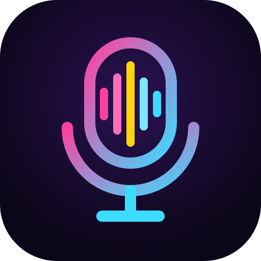
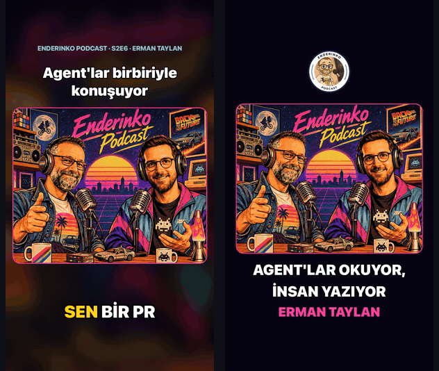

<p align="center"></p>

<h1 align="center">podcast-studio</h1>

<p align="center"><a href="https://enderahmetyurt.github.io/podcast-studio/">Website</a> · <a href="#install">Install</a> · <a href="#quick-start">Quick start</a></p>

Podcast production skills for [Claude Code](https://claude.com/claude-code). Drop in a recording, get back:

- a **transcript**, an **episode description** in your own show-notes format, title ideas and chapters
- the **final episode mix**: spoken intro over theme music, the episode, outro, all loudness-normalized
- **short vertical clips** (9:16) of the best moments, with cover, title, waveform and word-by-word captions
- a **launch-day montage** (4:5 and 9:16): 6-8 punchy quotes over music, cover intro card, big animated text, branded end card
- **post copy** for Instagram, X, YouTube Shorts, TikTok and LinkedIn, tagging your guest

Works in any language Whisper supports. Runs locally: mlx-whisper on Apple Silicon, faster-whisper everywhere else.

<p align="center">
  
</p>
<p align="center"><sub>Left: <code>/podcast-clips</code> clip with word-by-word captions. Right: <code>/podcast-launch</code> montage. Both from <a href="https://enderin.co">Enderinko Podcast</a> S2E6 (in Turkish), the show this was built for.</sub></p>

## Install

```
/plugin marketplace add enderahmetyurt/podcast-studio
/plugin install podcast-studio@podcast-studio
```

Requirements: Python 3.10+, ffmpeg (`brew install ffmpeg`, `sudo apt install ffmpeg`, `winget install ffmpeg`). The setup skill creates a virtualenv in `~/.cache/podcast-studio-venv` with Pillow and Whisper; the first transcription downloads the model (~1.5 GB).

## Quick start

```
/podcast-setup ~/Podcasts/my-show
```

Claude asks about your show (name, language, links, colors, logo, music, a past episode description to copy the format from) and writes `podcast.json`. Then, from an episode folder:

| Command | What it does |
|---|---|
| `/podcast-episode recording.mp3 intro.m4a` | Transcript, description, chapters, final mix |
| `/podcast-clips recording.mp3 cover.png jane` | Picks 8-10 moments, you choose, it renders captioned 9:16 clips + copy |
| `/podcast-clips copy clips/ jane` | Copy only, for clips you already have |
| `/podcast-launch .` | Launch-day montage video in 4:5 and 9:16 + copy for every platform |

You can also just ask in plain words ("make reels from this episode"), the skills trigger on their own.

## Folder layout

```
my-show/
├── podcast.json          # show profile: language, links, brand, audio, description format
├── guests.json           # guest names, links and social handles, reused across episodes
├── assets/               # logo, theme music, outro, launch music
└── s01e04-jane-doe/
    ├── recording.mp3
    ├── cover.png
    ├── s01e04-transcript.txt
    ├── s01e04-description.md
    └── clips/
        ├── 03-the-day-it-broke.mp3 / .json
        └── video/
            ├── 03-the-day-it-broke.mp4
            ├── s01e04-launch-4x5.mp4
            └── clip-copy.md
```

See [`examples/podcast.json`](examples/podcast.json) for every option.

## How it works

The skills tell Claude the editorial part: which moments are worth clipping, where a sentence really starts, what a good hook looks like, how to match your description format. The scripts in [`scripts/`](scripts) do the media work and can be used on their own:

| Script | Purpose |
|---|---|
| `transcribe.py` | Timestamped transcript, optional word timings |
| `cut.py` | Cut clips from a list, transcribe each, print start/end text for boundary checks |
| `levels.py` | RMS levels around cut points, to cut in silence |
| `render_clip.py` | 9:16 clip video with captions |
| `launch.py` | Launch montage audio, then 4:5 / 9:16 / story video |
| `mix.sh` | Intro + theme music + episode + outro |

All text is drawn with Pillow, so a stock ffmpeg without libass or freetype is enough.

## Fonts and music

No fonts or music ship with the plugin. Without `brand.font_black` / `font_heavy`, a bold system font is used (Arial Black, DejaVu Sans Bold...). Use music you have the rights to. If no whoosh effect is set, one is synthesized with ffmpeg.

## Claude never posts for you

The skills produce files and copy. Uploading and posting stay with you.

## License

MIT
